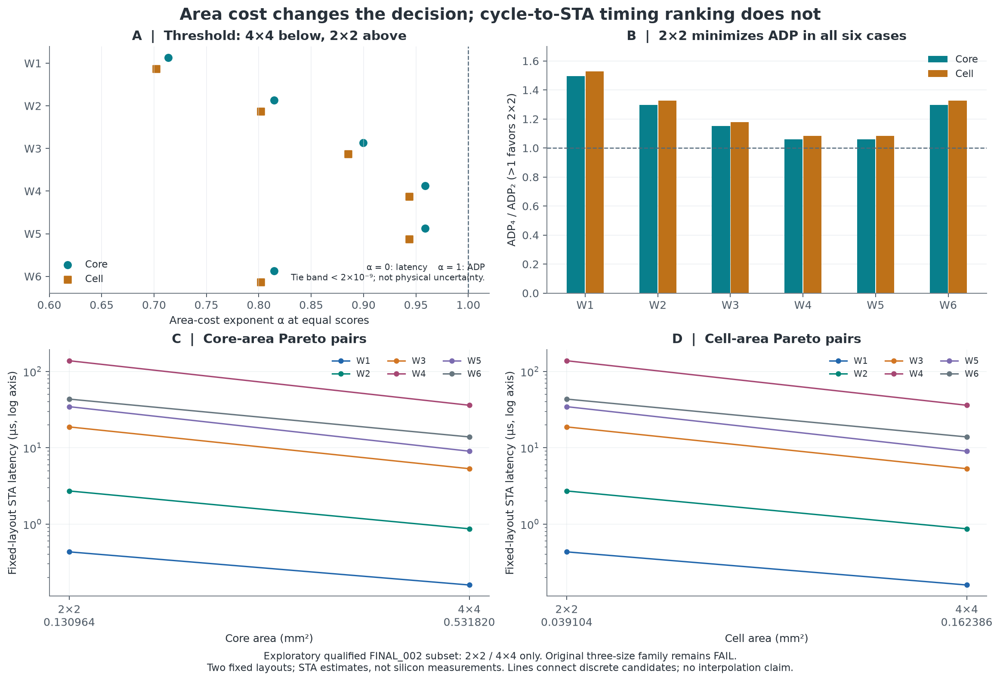

# Model2GDS: evidence-grounded design exploration

A small, offline research candidate that connects a systolic-array Python model,
recorded RTL observations and qualified historical ASIC evidence. This is a
**compact REPRO** snapshot from a fixed Round6 portable archive. It is a
standalone Explorer demonstration related to the existing ISSCC submission,
not a replacement for that submission or a complete RTL-to-GDS reproduction.

## Existing public research entry and release decision

The [official submission README](https://github.com/Fduzyx/sscs-ose-code-a-chip.github.io/blob/573b4f880c252d2b5900309d4de637dc6a861979/ISSCC27/submitted_notebooks/Model2GDS/README.md),
[executable submission Notebook](https://github.com/Fduzyx/sscs-ose-code-a-chip.github.io/blob/573b4f880c252d2b5900309d4de637dc6a861979/ISSCC27/submitted_notebooks/Model2GDS/Model2GDS.ipynb) and
[existing PR #205](https://github.com/sscs-ose/sscs-ose-code-a-chip.github.io/pull/205)
remain the research entry at pinned commit `573b4f880c252d2b5900309d4de637dc6a861979`. On 2026-10-11, GitHub
reported that PR open and unmerged. That submission records 2x2 qualified, 4x4
failed antenna signoff and 8x8 not run; it is not the later DAC evidence subset.

This Explorer uses separately indexed DAC round2 FINAL_002 records under
`results/raw/phase2/dac27/round2/physical/`, recipe
`flow/dac27_candidate_02.json`, for its independently qualified 2x2/4x4 subset.
Shared FINAL_002 labels do not make the official and DAC run directories the
same experiment. The full three-configuration family remains FAIL.

This standalone demonstration preserves pinned links to the existing research
entry. The submitted ISSCC branch, PR and active development tree remain
unchanged. The [release scope](docs/RELEASE_SCOPE.md) records this snapshot
and the limited local preparation checks.

## Problem

For a fixed GEMM workload, which of two qualified array implementations should
be selected under an area budget? A cycle count alone does not describe the
area/latency tradeoff. A useful demonstration must expose the exact input,
implementation identity, objective and evidence behind its recommendation.

## Approach

- The project's fixed-width arithmetic/golden and token-level models recompute
  six preserved GEMM workloads. The Explorer compares outputs, counted cycles
  and tile records with saved RTL observations; the animated state is Python.
- Historical OpenLane/OpenROAD/SKY130 records supply core/cell areas and
  fixed-layout register-to-register (R2R) STA estimates for FINAL_002 2x2/4x4.
- Selection first filters `area <= budget`, then minimizes cycles, estimated
  latency, ADP, or `latency * area**alpha`. Core and standard-cell instance area
  are distinct budget definitions. Exact preference thresholds retain ties.
- Read-only provenance maps accumulator state to named placed flip-flops,
  DEF coordinates and GDS references. It does not infer PE geometry regions.

The original implementation work is the model/RTL validation and this compact
integration/evidence analysis. Jupyter/ipywidgets and the EDA/PDK tools are
third-party tools. No new optimization algorithm is claimed.

## Try the dependency-free part

Python 3.12+ is the package's documented runtime. From this directory:

```text
python -B evidence/verify.py
python -B app.py --workload W4 --objective weighted --alpha 0.95 --area-metric core
python -B app.py --workload W4 --objective weighted --alpha 0.95 --area-metric cell
python -B checks/verify_candidate.py
```

These commands verify bundled records, recompute Python traces and make current
selection calculations. They do not run an RTL simulator, synthesis, P&R, STA
or signoff. No network, Docker, PDK or parent repository is needed.

## Interactive Explorer

After separately preparing the pinned dependencies in `requirements.txt`, run:

```text
python -B launch.py
```

Wait for the kernel to become Idle, then choose **Run > Run All Cells** in
`Explorer.ipynb`. Notebook installation and browser interaction were NOT_RUN
in this staging round. `requirements-validated-linux.txt` is the preserved
historical environment record, not a newly certified cross-platform lock.

The original [five-minute walkthrough](docs/ROUND6_PACKAGE_README.md) covers
objective changes, Core/Cell area, alpha thresholds, budgets, current Python
animation, confirmed register positions and the two historical layout images.
Changing area basis resets the numeric budget preset. Reload the browser before
Run All after restarting a kernel if widgets retain a stale session identifier.
Stop the kernel/server from Jupyter or interrupt its foreground terminal;
closing a browser tab alone does not terminate the server.

## Evidence

| Evidence | What the preserved records support |
|---|---|
| `evidence/raw/historical_functional_qualification.json` | Historical 441/441 case/configuration executions passed numerical and cycle checks: 147 each at 2x2, 4x4 and 8x8. This is not a fresh 441-case run. |
| `evidence/functional_cases.json`, `raw/rtl_S*_selected.jsonl` | Twelve compact saved RTL observations: six fixed workloads at each of 2x2/4x4. Current Python can independently replay these inputs. |
| `evidence/physical.json` and selected raw state/STA logs | Independently qualified historical FINAL_002 2x2/4x4 members. The original three-configuration physical family remains FAIL. |
| `research/decisions.json` and figures | Derived decisions from those two fixed layouts. All six workloads prefer 4x4 for cycles/STA latency and 2x2 for Core/Cell ADP. At W4/W5 and alpha=0.95, Core selects 4x4 while Cell selects 2x2; this is an area-definition effect, not a timing reversal. |
| `research/mapping.json`, excerpts, named GDS references and SVGs | 128/512 accumulator flip-flops, 640 total, are traced by retained state, final instance, DEF origin and named GDS reference; two selected STA launch endpoints are also checked. |

Historical tool metrics are:

| FINAL_002 member | Core area (um^2) | Cell instance area (um^2) | Internal R2R STA period estimate (ns) |
|---|---:|---:|---:|
| 2x2 | 130964 | 39103.8 | 15.418418 |
| 4x4 | 531820 | 162386 | 14.442339 |

Area keys and original state sources are in `evidence/physical.json`; period is
`20 ns constraint - recorded setup worst slack` from the preserved R2R logs,
at corner `max_ss_100C_1v60`. Estimated workload latency is recorded RTL cycles
multiplied by that period; ADP multiplies that latency by the declared area.
The same two layouts are reused for all six workloads, not six independent
physical replications. The mapping sources and their hashes are bound by
`research/manifest.json`. Existing GDS images omit standard-cell internals
according to `assets/layout_manifest.json` and `NOTICE`.

Preserved R3 checks and their exact scope are in `VALIDATION.json`.
The small R5 preparation check is recorded in [release scope](docs/RELEASE_SCOPE.md).
Read [the evidence and stage boundaries](docs/EVIDENCE_AND_VERSION_BOUNDARIES.md)
before interpreting any PASS; neither check is fresh RTL or EDA evidence.



## Limitations

- No chip was measured. STA-derived period/frequency is not measured silicon
  Fmax, complete IO timing closure, power, or whole-system latency.
- 8x8 has no completed qualified physical metrics and is excluded from selection.
  The original FINAL_002 three-size family remains FAIL despite qualified 2x2/4x4.
- This is post-result exploration of one recipe and two layouts. The Pareto
  points are discrete candidates, not a continuous realizable design frontier.
- Mapping is structural provenance, not renewed formal arithmetic equivalence,
  per-PE area/delay, routed-path reconstruction, or proof the displayed input
  exercises the historical STA critical path.
- This compact archive includes model code, not RTL source or the full 441-case
  runner. It supports selected model/evidence replay and reading; it cannot
  reproduce a complete RTL or physical signoff audit by itself.
- No new EDA/FPGA experiment or publication action occurred in this staging round.

## License and provenance

The existing archive's Apache-2.0 `LICENSE`, `NOTICE` and upstream license copies
are preserved. This staging task did not assign a new license or expand third-
party rights. See [LICENSE_REVIEW.md](LICENSE_REVIEW.md) before publication.

The local owner-only source manifest was excluded from this review tree.
`FILE_MANIFEST.sha256` records this tree using relative paths; private provenance
is kept separately and must never enter a public Git tree. No .git history, credentials,
PDK installation, complete GDS/SPEF, toolchain or large raw archive was copied.

中文简述：本候选展示固定 GEMM 输入的 Python/历史 RTL 一致性、两套已有合格
ASIC 的可解释选择及寄存器物理来源。当前仅重放精选证据，不复做 RTL 或 EDA；
8x8 与三配置物理研究未完成，所有面积和时序均为工具报告，不是芯片实测。
